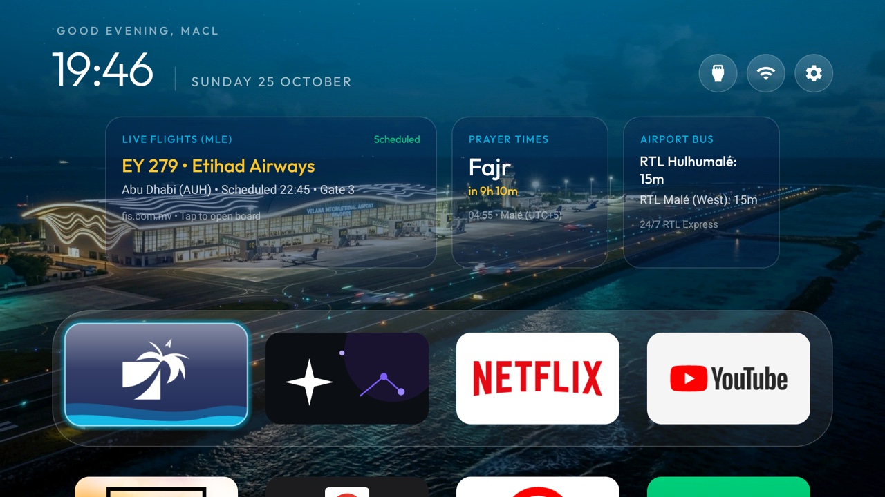

# MACL TV Launcher

An ultra-premium, lightweight, tvOS-inspired Android TV launcher built specifically for **Maldives Airports Company Limited (MACL)** living rooms, executive lounges, and terminal information displays.



## Features

- **Living Room Dashboard Widgets**:
  - **Live Flight Information Display (FIS)**: Direct live status updates for Velana International Airport (`MLE`) departures and arrivals (`fis.com.mv`), highlighting flight numbers, destination, status, and gate numbers.
  - **Live Prayer Times Countdown**: Next prayer countdown calculation for Malé / Hulhulé (UTC+5), displaying time remaining and next prayer name.
  - **Airport Bus Schedule**: Real-time departure countdowns for RTL Hulhumalé and RTL Malé Express routes.
- **tvOS Aesthetics & Motion**:
  - Frosted glass cards with smooth `1.05x` focus elevation animations and glowing turquoise focus rings (`#00B2E3`).
  - Floating bottom dock with frosted glass styling and squircle application tiles.
  - Top header with greeting, large clock, and clean round icon controls for Inputs, Wi-Fi, and Settings.
- **Integrated Theme System**:
  - Support for multiple airport color schemes (`macl-default`, `macl-midnight`, `macl-lagoon`, `macl-sunrise`).
  - Seamless theme pushing and switching on the fly over ADB.
- **Performance & Privacy**:
  - Pure Java with AndroidX DynamicAnimation and RecyclerView.
  - Ultra-lean footprint (< 480 KB release APK).
  - High performance on smart TV hardware (tested on Android TV 11 MediaTek boards).

---

## Repository Structure

```
macl-tv-launcher/
├── app/                  # Main Android TV Launcher app (com.macl.tvlauncher)
│   ├── src/main/
│   │   ├── java/         # Launcher core, widgets, and dynamic theming
│   │   └── res/          # Layouts, vector assets, and configurations
├── themes/               # Pre-configured visual themes
│   ├── macl-default/     # Classic MACL Evening with airport apron backdrop
│   ├── macl-midnight/    # Pure OLED deep black with neon cyan glow
│   ├── macl-lagoon/      # Tropical Velana lagoon teal and gold
│   └── macl-sunrise/     # Maldives dawn twilight and coral glow
└── scripts/              # Build, install, and theme deployment utilities
    ├── build.sh          # Compiles release APK
    ├── install.sh        # Deploys APK and configures TV home
    └── switch-theme.sh   # Pushes theme to the TV
```

---

## Quick Start

### Prerequisites
- JDK 17
- Android SDK (platform 34, build-tools 34.0.0)
- Smart TV connected via ADB (Wi-Fi, Ethernet, or Tailscale)

### 1. Build Release APK
```bash
./scripts/build.sh
```

### 2. Deploy to TV
```bash
# Set your TV IP and install
TV_HOST=100.83.39.24 ./scripts/install.sh
```

### 3. Switch Themes
```bash
# Apply OLED Midnight theme
TV_HOST=100.83.39.24 ./scripts/switch-theme.sh themes/macl-midnight

# Switch back to Classic Evening theme
TV_HOST=100.83.39.24 ./scripts/switch-theme.sh themes/macl-default
```

---

## License
MIT License. Created for Maldives Airports Company Limited.
